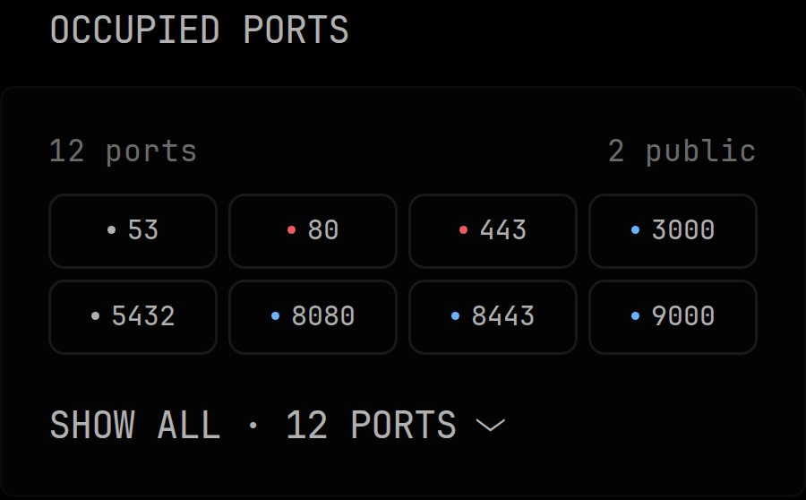

# Occupied Ports Widget for Glance


A tiny helper service that exposes **currently published Docker host ports** as JSON for a Glance widget.

It is useful when you are about to deploy a new service and want a quick, human-friendly view of which host ports are already occupied — and whether they are exposed on **loopback**, **Tailscale**, **private LAN**, or **all interfaces/public**.

---

## Screenshot



---

## Features

- Dynamic port discovery from running Docker containers
- Deduplicated by **host port** with protocol aggregation
- Exposure metadata per port:
  - `host_ips`
  - `primary_host_ip`
  - `exposure_scope`
  - `exposure_scopes`
  - `private_ports`
- Optional source-container reporting with `SHOW_SOURCE=true`
- Sorting modes: `asc`, `desc`, `recent` (`recent` means first observed by this process; resets on restart)
- Port range filter (`MIN_PORT`, `MAX_PORT`)
- Reserved port hints in payload (for example `22`, `53`, `80`, `443`)
- Clickable links per port (`LINK_SCHEME://LINK_HOST:port`)
- Discovers Docker published ports only; host-network containers and non-Docker listeners are not included
- JSON API (`/ports`) and ready-made HTML widget (`/widget`)
- Optional token auth and rate limiting for safer public use
- Production-oriented runtime (Gunicorn, non-root user, healthcheck)
- CI with tests and Docker build verification

---

## API shape

Example `GET /ports` response (addresses and container names are illustrative):

```json
{
  "ok": true,
  "error": "",
  "sort_mode": "asc",
  "min_port": 1,
  "max_port": 65535,
  "count": 2,
  "items": [
    {
      "port": 53,
      "proto": "tcp",
      "protocols": ["tcp", "udp"],
      "url": "https://example.com:53",
      "reserved": true,
      "reserved_label": "DNS",
      "primary_host_ip": "100.64.0.10",
      "host_ips": ["100.64.0.10", "127.0.0.1"],
      "exposure_scope": "mixed",
      "exposure_scopes": ["tailscale", "loopback"],
      "private_ports": [53],
      "source": "glance, pihole",
      "sources": ["glance", "pihole"],
      "source_count": 2
    },
    {
      "port": 8088,
      "proto": "tcp",
      "protocols": ["tcp"],
      "url": "https://example.com:8088",
      "reserved": false,
      "reserved_label": "",
      "primary_host_ip": "127.0.0.1",
      "host_ips": ["127.0.0.1"],
      "exposure_scope": "loopback",
      "exposure_scopes": ["loopback"],
      "private_ports": [8080]
    }
  ]
}
```

### Exposure scope meanings

- `public` → bound to `0.0.0.0` / `::` or a public IP; this describes the bind address, not firewall/NAT reachability
- `tailscale` → bound to Tailscale address range
- `private` → bound to RFC1918/private non-loopback address
- `loopback` → bound to `127.0.0.1` / `::1`
- `mixed` → the same host port is published on multiple scopes
- `unknown` → bind address could not be classified

---

## Endpoints

- `GET /health`
- `GET /ports`
- `GET /widget`

`/ports` is the structured API for Glance `custom-api` templates.

`/widget` is a ready-made HTML view that includes:
- scope-aware chip styling
- hover tooltips with bind IPs, protocols, and sources
- lightweight auto-refresh polling

---

## Quick start

```bash
git clone https://github.com/js-surya/occupied-ports-widget.git
cd occupied-ports-widget
docker compose up -d --build
curl http://127.0.0.1:8789/health
curl http://127.0.0.1:8789/ports
```

Expected:

- `/health` returns `{"ok": true}`
- `/ports` returns JSON with `ok`, `count`, and `items`

---

## Docker Compose

The included compose file uses:

- loopback-only bind for the widget: `127.0.0.1:8789:8789`
- pinned socket proxy image: `tecnativa/docker-socket-proxy:v0.4.2`
- restricted Docker API scope: `CONTAINERS=1`, `POST=0`

Start it with:

```bash
docker compose up -d --build
```

---

## Configuration

Environment variables:

- `PORT` (development server only, default: `8789`; Docker/Gunicorn listens on `8789`)
- `DOCKER_API` (default: `http://occupied-ports-docker-proxy:2375/containers/json`)
- `TIMEOUT_SECONDS` (default: `6`)
- `CACHE_SECONDS` (default: `1`)
- `MIN_PORT` / `MAX_PORT` (defaults: `1` / `65535`)
- `SORT_MODE` (`asc` | `desc` | `recent`, default: `asc`)
- `SHOW_SOURCE` (`true|false`, default: `false`)
- `LINK_SCHEME` (default: `http`)
- `LINK_HOST` (default: `localhost`)
- `AUTH_ENABLED` (`true|false`, default: `false`)
- `WIDGET_TOKEN` (required when `AUTH_ENABLED=true`)
- `RATE_LIMIT_PER_MINUTE` (default: `120`)
- `DEBUG_ERRORS` (`true|false`, default: `false`)
- `TRUST_PROXY` (`true|false`, default: `false`)
- `FRAME_ANCESTORS` (default: `'self'`; space-separated origins permitted to embed `/widget`)

### Most useful options

- `SHOW_SOURCE=true` → include container names in API and widget tooltips
- `LINK_HOST=your-domain-or-ip` → make links point somewhere meaningful
- `AUTH_ENABLED=true` + `WIDGET_TOKEN=...` → required if exposed beyond private access
- `RATE_LIMIT_PER_MINUTE=30` → safer for public/reverse-proxied deployments

---

## Glance examples

For containerized Glance, the default loopback bind is not reachable through
`host.docker.internal`. A portable option is a shared Docker network:

```bash
docker network create glance-ports
```

Add this to an override for **each** Compose project (use `glance` as the service
name in the Glance project and `occupied-ports-widget` in this project):

```yaml
services:
  occupied-ports-widget:
    networks:
      - default
      - glance-ports
networks:
  glance-ports:
    external: true
```

Recreate both services after configuring the network. Keep the Docker socket
proxy on this project's default network only. The `custom-api` examples below
use the widget's service name on the shared network. No extra host port bind
is needed. If Glance runs directly on the host, use `http://127.0.0.1:8789/ports`.


### Minimal `custom-api` example

```yaml
- type: custom-api
  title: Occupied Ports
  cache: 10s
  url: http://occupied-ports-widget:8789/ports
  template: |
    <ul class="list">
      {{ range .JSON.Array "items" }}
        <li>{{ .Int "port" }}</li>
      {{ end }}
    </ul>
```

### Recommended `custom-api` example with scope hints

```yaml
- type: custom-api
  title: Occupied Ports
  cache: 15s
  url: http://occupied-ports-widget:8789/ports
  template: |
    <style>
      .ports-grid {
        display: grid;
        grid-template-columns: repeat(4, minmax(0, 1fr));
        gap: 0.4rem;
      }
      .ports-grid > li {
        list-style: none;
        margin: 0;
      }
      .port-chip {
        display: block;
        text-align: center;
        padding: 0.28rem 0.2rem;
        border-radius: 6px;
        border: 1px solid color-mix(in srgb, var(--color-text-base) 16%, transparent);
        background: color-mix(in srgb, var(--color-widget-background) 82%, var(--color-text-base) 18%);
        font-size: 1rem;
        font-weight: 600;
        color: var(--color-text-base);
        text-decoration: none;
      }
      .port-chip.public { border-color: color-mix(in srgb, #ff7b72 46%, transparent); }
      .port-chip.tailscale { border-color: color-mix(in srgb, #6eb6ff 46%, transparent); }
      .port-chip.private { border-color: color-mix(in srgb, #f2cc60 42%, transparent); }
      .port-chip.loopback { border-color: color-mix(in srgb, #3fb950 42%, transparent); }
      .port-chip.mixed { border-style: dashed; }
      .port-chip.reserved {
        background: color-mix(in srgb, var(--color-widget-background) 75%, var(--color-primary) 25%);
        color: var(--color-primary);
      }
    </style>
    {{ if not (.JSON.Bool "ok") }}
      <div class="color-negative size-h5">Data unavailable</div>
      <div class="color-subdue">{{ .JSON.String "error" }}</div>
    {{ else }}
      <ul class="list ports-grid collapsible-container" data-collapse-after="16">
        {{ range .JSON.Array "items" }}
          <li>
            <a
              class="port-chip {{ .String "exposure_scope" }} {{ if .Bool "reserved" }}reserved{{ end }}"
              href="{{ .String "url" }}"
              target="_blank"
              rel="noreferrer"
              title="{{ .String "exposure_scope" }} · {{ .String "primary_host_ip" }}"
            >
              {{ .Int "port" }}
            </a>
          </li>
        {{ end }}
      </ul>
    {{ end }}
```

### Automatic updates in an open Glance page

Glance `custom-api` caching alone does not refresh an open page. To make ports
appear and disappear automatically while keeping Glance's theme, install the
optional script tested with Glance v0.8.7:

1. Copy `integrations/glance/occupied-ports-live.js` into your Glance assets directory.
2. Add this at the top level of Glance's configuration (merge with an existing `document.head`):

   ```yaml
   document:
     head: |
       <script src="/assets/occupied-ports-live.js" defer></script>
   ```

3. Add these properties to the Occupied Ports `custom-api` widget:

   ```yaml
   css-class: occupied-ports-live
   cache: 1s
   ```

Reload the browser once after setup. The script requests Glance's page-content
endpoint every three seconds and updates only marked widgets when their content
changes. It preserves Show more/Show less state, pauses in hidden tabs, and
shows a retry message if refreshing fails. Requests use Glance's own origin and
session; no helper token is exposed to the browser. Other widgets keep their
normal cache durations, although the page-content request can refresh them on
the server when their caches expire.

The helper caches Docker data for one second by default. Under normal local
conditions a started container's port appears, or a stopped container's port
vanishes, within roughly 3–5 seconds. This is polling, not Docker event streaming.
A process crash inside a still-running container does not remove a published
binding. The widget tracks Docker bindings rather than application health.

If Glance uses `server.base-url`, prefix the script's `/assets/` URL accordingly.
This optional integration uses Glance's page-content endpoint and should be
retested when upgrading Glance.

### Ready-made iframe widget example

If you prefer using the built-in HTML widget instead of writing a template:

```yaml
- type: iframe
  title: Occupied Ports
  source: https://ports.example.com/widget
  height: 220
```

The iframe URL must be reachable by the **browser**, not just the Glance
container. Replace `ports.example.com` with your helper's HTTPS reverse proxy
address. Configure the helper with `FRAME_ANCESTORS: "https://glance.example.com"`
using the exact Glance origin (including port if nonstandard). The default
`'self'` permits embedding only from the helper's own origin.

When auth is enabled, a browser iframe cannot set `X-Widget-Token`. Use an
access-controlled reverse proxy that injects the token for both `/widget` and
`/ports`; polling requests need the header too. The proxy must preserve these
sibling paths, including when serving under a URL prefix. Never put the token
in the iframe URL. For `custom-api`, set the header in the widget config:

```yaml
headers:
  X-Widget-Token: ${OCCUPIED_PORTS_TOKEN}
```

Define `OCCUPIED_PORTS_TOKEN` in the Glance container environment and match it to
the helper's `WIDGET_TOKEN`.

---

## Public-safe deployment

If anyone on the internet may reach this helper, treat it as sensitive operational metadata.

Recommended minimums:

1. Keep the container bound to loopback only:
   ```yaml
   ports:
     - "127.0.0.1:8789:8789"
   ```
2. Put it behind HTTPS reverse proxy
3. Enable token auth:
   ```yaml
   environment:
     AUTH_ENABLED: true
     WIDGET_TOKEN: change-me-long-random-token
   ```
4. Lower rate limit:
   ```yaml
   environment:
     RATE_LIMIT_PER_MINUTE: 30
   ```
5. Use `TRUST_PROXY=true` only when actually behind a trusted reverse proxy
6. Consider `SHOW_SOURCE=false` if you do not want to reveal container names

A typical public-safe env block:

```yaml
environment:
  LINK_SCHEME: https
  LINK_HOST: your-public-host.example.com
  AUTH_ENABLED: true
  WIDGET_TOKEN: change-me-long-random-token
  RATE_LIMIT_PER_MINUTE: 30
  DEBUG_ERRORS: false
  TRUST_PROXY: true
  SHOW_SOURCE: false
ports:
  - "127.0.0.1:8789:8789"
```

If your reverse proxy supports it, have it send `X-Widget-Token` to the upstream request.

---

## Security notes

- Docker socket access is sensitive. This project uses [`tecnativa/docker-socket-proxy`](https://github.com/Tecnativa/docker-socket-proxy) with minimal allowed scope.
- The default compose bind is loopback-only to avoid accidental public exposure.
- Optional token auth is supported via `AUTH_ENABLED=true` and request header `X-Widget-Token`.
- Error responses are sanitized by default with `DEBUG_ERRORS=false`.
- Published ports can reveal meaningful details about your stack; expose carefully.

---

## Development

Run tests locally:

```bash
python3 -m venv .venv
.venv/bin/pip install -r requirements.txt pytest
.venv/bin/python -m pytest -q
```

Build test:

```bash
docker build -t occupied-ports-widget:local .
```

---

## Upgrade

```bash
git pull --ff-only
git checkout v1.2.0
docker compose up -d --build
```

Keep your local Compose overrides. Verify `/health` and `/ports` after upgrading;
`/health` checks the process only, while `/ports` reports Docker API errors via
`ok: false`. A successful empty result has `ok: true` and `count: 0`.

## Changelog

See [CHANGELOG.md](CHANGELOG.md).

## License

MIT
